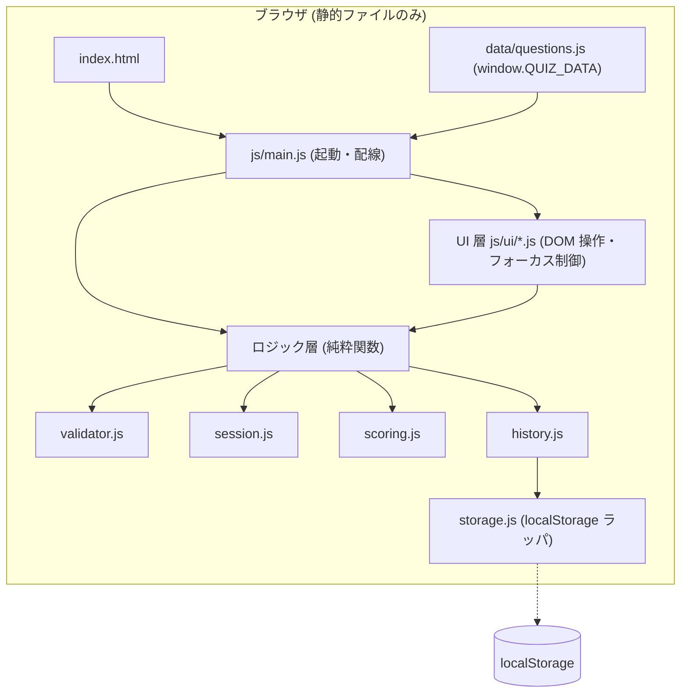
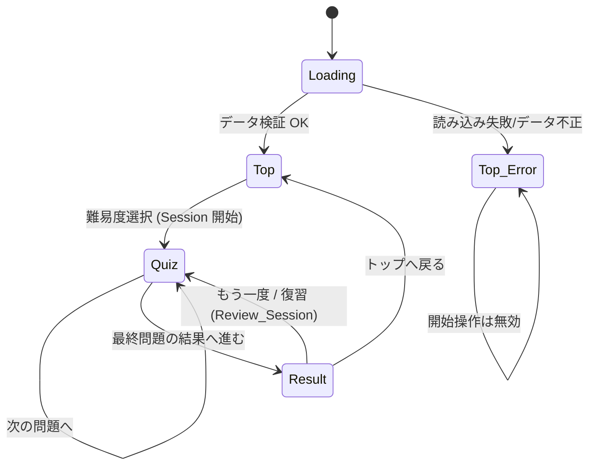
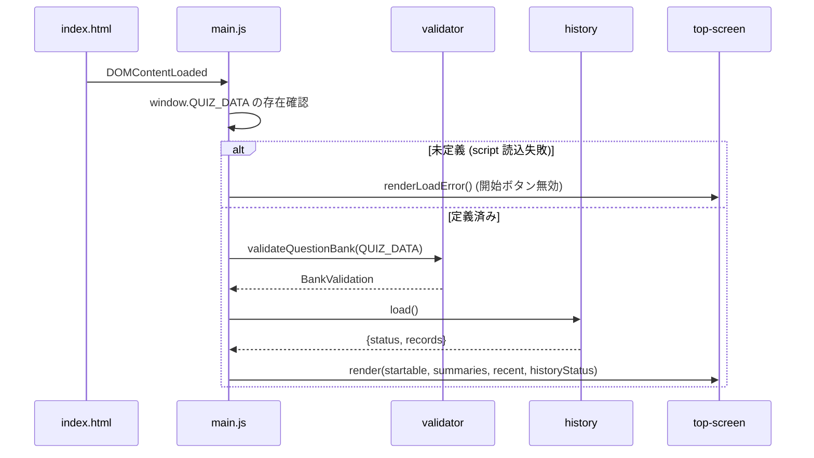

# 設計書

## Overview

本書は、社内研修用 AWS クイズ Web アプリケーション(Quiz_App)の設計を定義する。Quiz_App は HTML / CSS / JavaScript のみで構成される静的サイトであり、ビルド工程なしで GitHub Pages に配置でき、`file://` スキームでも同一動作する。

### 設計方針

- **ビルド不要**: トランスパイル・バンドル・minify・パッケージインストールを実行時には一切使わない。
- **`file://` 対応**: ES Modules(`<script type="module">`)や `fetch` / XHR は `file://` で CORS により失敗するため使用しない。すべてのスクリプトと問題データを、通常の `<script src="相対パス">` で読み込む。
- **純粋ロジックと UI の分離**: 判定・採点・検証・履歴の集計/直列化は DOM に依存しない純粋関数として実装し、テスト容易性を高める。DOM 操作は `ui/` 層に限定する。
- **相対パスのみ**: GitHub Pages のサブパス(`/リポジトリ名/`)で動くよう、すべての参照を `./` 起点の相対パスにする。
- **外部通信ゼロ**: CDN、Web フォント、外部 API を使用しない。フォントはシステムフォントスタックを使う。

### 調査結果と設計判断

| 論点 | 判断 | 根拠 |
|---|---|---|
| 問題データの読み込み | `data/questions.js` を `<script>` で読み込み、グローバル `window.QUIZ_DATA` に代入する | `file://` では `fetch("questions.json")` が CORS でブロックされるため。script タグ読み込みならローカルでも動作する |
| モジュール方式 | 名前空間 `window.QuizApp` に即時関数(IIFE)で登録する。Node 実行時は `module.exports` も公開する(UMD 風) | ES Modules は `file://` で動かない。一方でテストランナー(Node)から純粋ロジックを `require` できる必要がある |
| 画面遷移 | 単一 HTML 内で `<section>` の表示切替(SPA 方式)とし、URL 遷移は行わない | 画面遷移時にページ再読み込みが無く、フォーカス制御・状態保持が簡単 |
| 選択肢の並び | 出題時にシャッフルし、表示インデックスから元インデックスへの対応表を保持する | 要件 4.6: 表示順にかかわらず正解インデックスで判定 |
| 解説の構造 | 正解理由 1 件 + 誤り理由 3 件を選択肢インデックスで紐付けた構造化データにする | 要件 5.4 / 9.5 を機械的に検証・表示するため |
| 乱数 | シャッフルは乱数関数を引数で注入できる設計にする(既定は `Math.random`) | PBT で再現可能なテストにするため |
| テスト | Node.js 上で Vitest + fast-check(開発時のみ。配信物には含めない) | 既存ライブラリを使い、PBT を自作しない。ランタイムはビルド不要のまま |

## Architecture

### レイヤー構成



### 画面遷移



### スクリプト読み込み順(classic script、defer なしで末尾配置)

`data/questions.js` → `js/validator.js` → `js/scoring.js` → `js/session.js` → `js/storage.js` → `js/history.js` → `js/ui/*.js` → `js/main.js`

依存は前方のみ。`main.js` が最後に起動する。

### ファイル構成

```text
/ (リポジトリルート = GitHub Pages 公開ルート)
├── index.html                 # 単一ページ。lang="ja"、viewport メタタグ、3 画面の section
├── css/
│   ├── tokens.css             # 配色トークン(ネイビー/オレンジ)、サイズ変数
│   ├── base.css               # リセット、タイポ、フォーカス表示
│   └── components.css         # ボタン、選択肢、カード、メディアクエリ
├── data/
│   └── questions.js           # window.QUIZ_DATA = { questions: [...90問] }
├── js/
│   ├── validator.js           # 問題データ検証
│   ├── scoring.js             # 採点・評価コメント・整形
│   ├── session.js             # Session / Review_Session 状態遷移
│   ├── storage.js             # localStorage ラッパ(例外を握る)
│   ├── history.js             # 履歴レコード生成・集計・直列化
│   ├── ui/
│   │   ├── top-screen.js
│   │   ├── quiz-screen.js
│   │   ├── result-screen.js
│   │   └── focus.js           # 画面遷移時のフォーカス移動
│   └── main.js                # 起動、イベント配線、画面切替
├── tests/                     # 開発時のみ(Vitest + fast-check)
│   ├── unit/ ...
│   └── property/ ...
├── package.json               # テスト専用 devDependencies(配信物ではない)
└── README.md
```

`package.json` と `tests/` は開発者のテスト用であり、アプリの実行には不要である。実行時に `npm install` は必要ない(要件 1.2)。

## Components and Interfaces

すべて `window.QuizApp.<モジュール名>` に公開する。以下は TypeScript 風の記法でインターフェースを示す(実装は素の JavaScript、JSDoc で型注釈)。

### validator.js

```ts
type Difficulty = "beginner" | "basic" | "intermediate";

interface ValidationIssue { questionId: string | null; rule: string; message: string; }
interface BankValidation {
  validQuestions: Question[];        // 個別検証を通過した問題のみ
  issues: ValidationIssue[];         // 検出した違反すべて
  countsByDifficulty: Record<Difficulty, number>; // validQuestions の難易度別件数
  startable: Record<Difficulty, boolean>;         // 各難易度が 30 問揃っているか
}

validateQuestion(q: unknown): ValidationIssue[];       // 要件 4.7 / 9.2 / 9.4 / 9.5 / 9.15
validateQuestionBank(raw: unknown): BankValidation;    // 要件 3.5 / 9.1 / 9.6 / 9.14
```

`validateQuestion` の検査項目:

1. `id` が非空文字列
2. `difficulty` が 3 値のいずれか
3. `text` が 1〜300 文字
4. `choices` が長さ 4 の配列で、各要素が 1〜100 文字、`trim()` 後に相互に異なる
5. `answerIndex` が 0〜3 の整数
6. `explanation.correct` が非空、`explanation.incorrect` が正解以外の 3 インデックスをキーとして持ち、すべて非空
7. 解説全体(正解理由 + 誤り理由 3 件の合計文字数)が 1〜1,000 文字

`validateQuestionBank` は、個別検証に通った問題のみを `validQuestions` とし、ID の一意性と、同一 Difficulty 内の問題文重複(`trim()` 後比較)も検査する。重複した場合は後から現れた問題を除外し issue を記録する。`startable[d]` は `validQuestions` 中の難易度 d の件数が 30 のときのみ true である。

### scoring.js(純粋関数)

```ts
calcScore(correct: number, total: number): { correct: number; total: number; percentFloor: number; percentRounded1: number };
// percentFloor    = Math.floor(correct / total * 100)     … 結果画面(要件 6.1)
// percentRounded1 = Math.round(correct / total * 1000) / 10 … 履歴(要件 8.1)

evaluationTier(percentFloor: number): "top" | "high" | "mid" | "review"; // 要件 6.2〜6.6
evaluationComment(tier): string;
formatProgress(n: number, m: number): string;     // "第 N / M 問"
formatCorrectCount(x: number): string;            // "正答数: X"
```

評価区分: 90〜100 → `top`、70〜89 → `high`、50〜69 → `mid`、0〜49 → `review`。`total = 0` は呼び出し側で発生させない(Session は 1 問以上のときのみ生成)が、`calcScore` は防御的に 0 を返す。

### session.js(状態遷移は不変更新の純粋関数)

```ts
interface SessionState {
  kind: "normal" | "review";
  difficulty: Difficulty;
  questions: PresentedQuestion[];   // 出題順の問題(選択肢は表示順にシャッフル済み)
  currentIndex: number;             // 0 始まり
  answers: (Answer | null)[];       // 問題ごとの解答(未解答は null)
  correctCount: number;
  finished: boolean;
}
interface PresentedQuestion {
  id: string;
  text: string;
  choices: { text: string; originalIndex: number }[]; // 表示順
  answerDisplayIndex: number;       // 表示順上の正解位置
  explanation: Explanation;
}
interface Answer { selectedDisplayIndex: number; isCorrect: boolean; }

createSession(bank: Question[], difficulty: Difficulty, rng?: () => number): SessionState; // 要件 3.2〜3.6
createReviewSession(prev: SessionState, rng?): SessionState | { error: string };            // 要件 7.2, 7.7
submitAnswer(state: SessionState, displayIndex: number): SessionState; // 初回のみ反映(要件 4.5, 5.5)
advance(state: SessionState): SessionState;                            // 次の問題 or finished
wrongQuestions(state: SessionState): PresentedQuestion[];              // 誤答集合
canReview(state: SessionState): boolean;                               // 誤答 >= 1(要件 7.1, 7.5, 7.6)
shuffle<T>(arr: T[], rng?): T[];                                       // Fisher–Yates、入力を破壊しない
```

- `createSession` は検証済み `bank` から指定難易度の全問(30 問)を重複なく取り、出題順と各問題の選択肢をシャッフルする。前回 Session の情報は引数に取らないため、状態は必ず初期化される(正答 0、回答 0)。
- `submitAnswer` は当該問題が解答済み(`answers[currentIndex] !== null`)なら同一の state を返す。これにより再選択は正答数・判定を変えない。
- `createReviewSession` は `prev` の誤答問題のみで構成する。誤答が 0 件の場合は `{ error }` を返し、UI は結果表示を維持してエラーを表示する。

### storage.js

```ts
isAvailable(): boolean;                        // localStorage への read/write 試行で判定
read(key: string): { ok: true; value: string | null } | { ok: false; error: string };
write(key: string, value: string): { ok: true } | { ok: false; error: string };
remove(key: string): { ok: boolean };
```

`localStorage` アクセス(プライベートモード、容量超過、アクセス拒否)で発生する例外はすべて捕捉し、`{ ok: false }` として返す。

### history.js

```ts
interface HistoryRecord {
  difficulty: Difficulty;
  playedAt: string;       // ISO 8601 (ミリ秒精度) 例: 2025-01-01T12:34:56.789Z
  correct: number;        // 0..total
  total: number;          // >= 1
  percent: number;        // 0.0..100.0 (小数点第1位に四捨五入)
}
createRecord(difficulty, correct, total, now?: Date): HistoryRecord;       // 要件 8.1
serialize(records: HistoryRecord[]): string;                               // JSON 文字列
parse(text: string | null): HistoryRecord[];                               // 破損時は有効なレコードのみ/空(要件 8.9)
summarize(records: HistoryRecord[]): Record<Difficulty, DifficultySummary | null>; // 要件 8.2, 8.3, 8.5
recent(records: HistoryRecord[], limit = 10): HistoryRecord[];             // 新しい順(要件 8.4)
load(): { status: "ok" | "unavailable"; records: HistoryRecord[] };
append(record): { ok: boolean };
clear(): { ok: boolean };                                                  // 要件 8.10
interface DifficultySummary { latest: HistoryRecord; bestPercent: number; attempts: number; }
```

保存形式(localStorage キー `aws-quiz-app:history:v1`)は次のとおり。

```json
{ "version": 1, "records": [ { "difficulty": "basic", "playedAt": "2025-01-01T12:34:56.789Z", "correct": 24, "total": 30, "percent": 80.0 } ] }
```

`parse` はトップレベルが上記形でない場合や JSON として解析できない場合は空配列を返し、例外を投げない。レコード単位では必須項目の欠落・型不正・範囲外(`correct > total`、`total < 1`、`percent` が 0〜100 外、`playedAt` が ISO 8601 として不正)を無効として除外する。

### UI 層

| モジュール | 責務 |
|---|---|
| `top-screen.js` | 3 難易度のカード(名称 + 100 文字以内の説明 + 前回/最高/回数または「未挑戦」)、直近 10 件の履歴、データ/履歴エラー表示、履歴削除(確認ダイアログ) |
| `quiz-screen.js` | 問題文、4 選択肢ボタン、進捗/正答数、判定と解説(`aria-live="polite"` 領域)、「次の問題へ」/「結果を見る」ボタン |
| `result-screen.js` | Score(正答数と切り捨て正答率)、評価コメント、復習ボタン(条件付き)、全問正解メッセージ、トップ/再挑戦ボタン、Review の Score を元と別に表示 |
| `focus.js` | 画面切替後 500ms 以内に見出し(`tabindex="-1"`)または最初の主要操作要素へフォーカス移動 |
| `main.js` | 起動時に `window.QUIZ_DATA` の有無と検証、`state` の保持、画面切替、イベント配線 |

### 起動シーケンス



### 難易度の表示名と説明

| 識別子 | 名称 | 説明(100 文字以内) |
|---|---|---|
| beginner | AWS初心者 | クラウドの基本概念と、主要な AWS サービスの役割を学びます。 |
| basic | 基礎だけわかる初級者 | EC2・S3・VPC・IAM などの基本操作と設計の入り口を学びます。 |
| intermediate | 中級エンジニア向け | 可用性・セキュリティ設計、コスト最適化、サーバーレス連携を実務レベルで学びます。 |

### UI/アクセシビリティ設計

- **配色トークン**(`tokens.css`): ネイビー背景 `hsl(220 60% 18%)` 等(色相 200〜240°、明度 35% 以下)、オレンジのアクセント `hsl(30 95% 55%)` 等(色相 20〜40°、彩度 80% 以上)。本文とのコントラスト 4.5:1、ボタンラベル/見出し 3:1 以上を満たす組み合わせのみを使用し、トークン値は単体テストでコントラスト比を検算する。
- **レスポンシブ**: 既定(モバイルファースト)で 1 カラム、`@media (min-width: 768px)` でコンテンツ領域を `max-width: 960px; margin-inline: auto`。320px 以上で横スクロールを出さないため `min-width: 0` と折り返し(`overflow-wrap: anywhere`)を使う。320px 未満では `overflow-x: auto` を許容する。
- **タップ領域**: `button { min-height: 44px; min-width: 44px; }`。
- **フォーカス表示**: `:focus-visible { outline: 3px solid <高コントラスト色>; outline-offset: 2px; }`。ネイビー背景に対して 3:1 以上の色を使う。
- **判定の識別**: 色に加え「✓ 正解」「✗ 不正解」の文字とアイコンを付与する。
- **ライブリージョン**: 判定 + 解説を `<div id="feedback" aria-live="polite" role="status">` 内に挿入する。挿入は判定確定と同期で行う。
- **キーボード**: 選択肢は `<button>` で実装し、Tab / Shift+Tab / Enter / Space をネイティブ機能で得る。DOM 順 = 視覚順とし `tabindex` に正の値は使わない。キートラップを作る要素(モーダル等)は使わず、履歴削除の確認は `window.confirm` を用いる。
- **フォーカス移動**: 画面切替ごとに該当画面の `h1` / `h2`(`tabindex="-1"`)へ `focus()` する。
- **lang**: `<html lang="ja">`。viewport は `width=device-width, initial-scale=1`。

## Data Models

### Question(問題データ)

`data/questions.js`:

```js
// 90 問すべて実内容で記述する。プレースホルダーや省略表記は含めない。
window.QUIZ_DATA = {
  version: 1,
  questions: [
    {
      id: "beginner-001",
      difficulty: "beginner",           // "beginner" | "basic" | "intermediate"
      text: "AWS が提供するオブジェクトストレージサービスはどれですか?",
      choices: ["Amazon S3", "Amazon EC2", "Amazon RDS", "AWS Lambda"],
      answerIndex: 0,                    // 0..3
      explanation: {
        correct: "Amazon S3 は耐久性の高いオブジェクトストレージです。",
        incorrect: {                     // 正解以外の 3 インデックスをキーに持つ
          "1": "Amazon EC2 は仮想サーバーであり、オブジェクトストレージではありません。",
          "2": "Amazon RDS はマネージドなリレーショナルデータベースです。",
          "3": "AWS Lambda はコードを実行するサーバーレスの計算サービスです。"
        }
      }
    }
  ]
};
```

制約(要件 9):

| フィールド | 制約 |
|---|---|
| `id` | 全体で一意な非空文字列(`<difficulty>-<3 桁連番>`) |
| `difficulty` | 3 種のいずれか |
| `text` | 1〜300 文字。同一 Difficulty 内で重複不可 |
| `choices` | 4 要素、各 1〜100 文字、`trim()` 後に相互に異なる |
| `answerIndex` | 0〜3 の整数。各 Difficulty 内で 0〜3 の各値が 4〜11 問 |
| `explanation` | `correct` 1 件 + `incorrect` 3 件(正解以外のインデックスがキー)。全体で 1〜1,000 文字 |

各 Difficulty 30 問、合計 90 問。オリジナル問題とし、公式試験問題の転載は行わない。

### Session 状態

前述 `SessionState` を参照。状態はメモリ内のみで保持し、localStorage には履歴(完了結果のみ)だけを書く。

### 履歴

前述 `HistoryRecord` と保存 JSON 形式を参照。

### エラー表示モデル

```ts
type AppError =
  | { kind: "load-failed"; message: string }      // script 未読込 (要件 1.6, 9.13)
  | { kind: "data-invalid"; message: string }     // 検証違反 (要件 3.5, 9.14)
  | { kind: "history-unavailable"; message: string }
  | { kind: "review-failed"; message: string }
  | { kind: "explanation-missing"; message: string };
```

## Correctness Properties

*A property is a characteristic or behavior that should hold true across all valid executions of a system-essentially, a formal statement about what the system should do. Properties serve as the bridge between human-readable specifications and machine-verifiable correctness guarantees.*

### プロパティ・リフレクション(冗長性の整理)

- 4.5 と 5.5(再選択不可)は同一内容のため Property 4 に統合した。
- 4.6 と 5.1(表示順によらず正解判定)は Property 3 に統合した。
- 3.6、6.8、6.9(Session の状態初期化)は Property 2 に統合した。
- 3.5、4.7、9.2、9.4、9.5、9.14、9.15(データ検証)は、「個別問題の検証」(Property 12)と「バンクレベルの検証」(Property 13)の 2 つに集約した。
- 8.6 と 8.7(JSON 保存とラウンドトリップ)は Property 11 に統合した。
- 6.2〜6.6 は評価区分が一意に決まる Property 7 に集約した。

### Property 1: Session は対象難易度の全問を重複なく出題する

*For any* 検証済みの問題集合と任意の Difficulty について、`createSession` の出題問題 ID の集合は当該 Difficulty の問題 ID の集合と等しく、重複を含まない。

**Validates: Requirements 3.3**

### Property 2: 新規 Session は常に初期状態から始まる

*For any* 先行する Session(任意の回答履歴・得点を持つもの)と任意の Difficulty について、新たに `createSession` した状態は `currentIndex = 0`、`correctCount = 0`、全 `answers` が未解答、`finished = false` であり、先行 Session の情報を含まない。

**Validates: Requirements 3.6, 6.8, 6.9**

### Property 3: 判定は表示順に依存せず正解インデックスに従う

*For any* 問題、任意のシャッフル結果、および任意の表示インデックス i について、`submitAnswer` による正誤判定は「選択肢 i の `originalIndex` が問題の `answerIndex` と等しいか」と一致し、シャッフル後の正解は常にちょうど 1 つの表示位置に存在する。

**Validates: Requirements 4.6, 5.1**

### Property 4: 解答の確定後は再選択しても状態が変わらない

*For any* Session 状態と問題、および任意の長さ 1 以上の選択操作列について、最初の選択のみが判定と `correctCount` に反映され、2 回目以降の `submitAnswer` は状態(`answers`、`correctCount`)を変更しない。

**Validates: Requirements 4.5, 5.5**

### Property 5: 進捗・正答数の整形が仕様形式に一致し範囲に収まる

*For any* 1 ≤ N ≤ M を満たす整数 N、M について、`formatProgress(N, M)` は「第 N / M 問」形式であり、*for any* Session の進行において、問題表示時の `correctCount` は 0 以上 N−1 以下である。

**Validates: Requirements 4.2, 4.3**

### Property 6: 正答率は切り捨てで計算され履歴用は小数第1位に丸められる

*For any* 整数 `total ≥ 1` と 0 ≤ `correct` ≤ `total` について、`calcScore` の `percentFloor` は `floor(correct / total × 100)` に等しく 0〜100 の整数であり、`percentRounded1` は `correct / total × 100` を小数第 1 位に四捨五入した 0.0〜100.0 の値である。

**Validates: Requirements 6.1, 8.1**

### Property 7: 評価コメントの区分は正答率に対してちょうど 1 つ決まる

*For any* 0〜100 の整数の正答率について、`evaluationTier` は 90〜100 → `top`、70〜89 → `high`、50〜69 → `mid`、0〜49 → `review` のうちちょうど 1 つを返し、区分の境界(90、70、50)で正しく切り替わる。

**Validates: Requirements 6.2, 6.3, 6.4, 6.5, 6.6**

### Property 8: 復習ボタンの表示可否は誤答の有無と一致する

*For any* 完了済み Session(通常・復習いずれも)について、`canReview` は誤答が 1 問以上あるときに限り true となり、全問正解のときは false となる。

**Validates: Requirements 7.1, 7.5, 7.6**

### Property 9: Review_Session は直前の誤答のみで構成される

*For any* 誤答を 1 問以上含む完了済み Session について、`createReviewSession` の出題問題 ID の集合は元の Session の誤答問題 ID の集合と等しく、その出題数 M と進捗表示の M は誤答数と一致する。

**Validates: Requirements 7.2, 7.3, 7.5**

### Property 10: 履歴レコードは必須項目と値域を満たし、集計は定義どおりになる

*For any* Difficulty、0 ≤ correct ≤ total、total ≥ 1 について `createRecord` は ISO 8601(ミリ秒精度)の `playedAt` と値域内の `percent` を持つレコードを返す。*For any* 履歴レコード列について、`summarize` の `latest` は当該 Difficulty で `playedAt` 最大のレコード、`bestPercent` は最大 `percent`、`attempts` は件数に等しく、記録のない Difficulty は `null`(「未挑戦」表示)となり、`recent` は長さ 10 以下で `playedAt` の降順である。

**Validates: Requirements 8.1, 8.2, 8.3, 8.4, 8.5**

### Property 11: 履歴のシリアライズはラウンドトリップで等価になる

*For any* 有効な履歴レコード列について、`serialize` → `parse` → `serialize` の結果は最初の `serialize` の結果と等しく、かつ `parse(serialize(x))` は `x` と等価である。

**Validates: Requirements 8.6, 8.7**

### Property 12: 破損した履歴データは例外を起こさず無効なレコードを含まない

*For any* 任意の文字列(JSON でないもの、型が不正なもの、必須項目が欠落したレコードを混在させた JSON を含む)について、`parse` は例外を投げず、返される全レコードが必須項目と値域を満たす。JSON として解析できないか構造が不正な入力には空配列を返す。

**Validates: Requirements 8.9**

### Property 13: 個別問題の検証は仕様どおりに合否を判定する

*For any* 生成された問題(境界長、選択肢数の過不足、選択肢の重複、`answerIndex` の範囲外、解説の欠落・空文字・文字数超過を含む)について、`validateQuestion` が空の issue 配列を返すのは、全制約(要件 9.2、9.4、9.5)を満たすときに限る。また検証を通過した任意の問題では、`answerIndex` が指す選択肢が存在し、`explanation.correct` と誤り理由 3 件がすべて非空である。

**Validates: Requirements 4.1, 4.7, 9.2, 9.4, 9.5, 9.15**

### Property 14: バンクレベルの検証は不正問題を除外し 30 問未満の難易度を開始不可にする

*For any* 有効・無効が混在する問題集合について、`validQuestions` は個別検証を通過した問題のみで構成され(不正問題は除外され)、`startable[d]` は検証通過後の難易度 d の問題数がちょうど 30 のときに限り true となる。また同一 Difficulty 内に問題文の重複がある場合は重複が除外され issue として報告される。

**Validates: Requirements 3.5, 4.7, 9.6, 9.14**

## Error Handling

| 事象 | 検出 | 動作 | 要件 |
|---|---|---|---|
| 必須リソース(CSS/JS/データ)の読み込み失敗 | `window.QUIZ_DATA` と `window.QuizApp.*` の存在確認。`<script onerror>` と `<link onerror>` でフラグを立てる | Top_Screen にエラーメッセージを表示し、難易度ボタンを `disabled` にする | 1.6, 9.13 |
| 問題データ不正(難易度ごとの件数、選択肢数、`answerIndex`、解説) | `validateQuestionBank` | 該当難易度(または全体)の開始を受け付けず、データ不正メッセージを表示。他の難易度が `startable` なら選択可能のまま維持 | 3.5, 9.14 |
| 出題中の不正問題 | 起動時の検証で除外。Session 生成時にも 1 問ごとに再検証 | 不正問題を出題対象から外し、データ不正メッセージを表示。`SessionState`(進行位置、正答数)は保持 | 4.7 |
| 解説の取得失敗 | `explanation` の構造チェック | 判定と正解強調は維持し、「解説を表示できません」を表示。「次の問題へ」/「結果を見る」ボタンは表示 | 5.10 |
| 復習対象を取得できない | `createReviewSession` が `{ error }` を返す | Result_Screen 上にエラーメッセージを表示し、直前の結果表示を維持 | 7.7 |
| localStorage 利用不可、読み書き失敗 | `storage.js` が例外を捕捉して `{ ok: false }` を返す | 履歴機能を無効扱いにし、Top_Screen に「履歴を利用できません」を表示。クイズは継続動作 | 8.8 |
| 履歴データ破損(JSON 解析失敗、必須項目欠落、型不正) | `history.parse` | 破損データを無視して空の履歴として表示。有効なレコードのみ採用。次回保存時に有効データで上書き | 8.9 |
| 履歴削除 | `window.confirm` | 承認時のみ全削除、キャンセル時は変更しない | 8.10 |
| 想定外の例外(UI イベントハンドラ) | `main.js` でのトップレベル `try/catch` | 一般エラーメッセージを `role="alert"` 領域に表示し、トップ画面へ戻れる状態を維持(キートラップなし) | 10.6 |

エラーメッセージは日本語で、`role="alert"`(致命的)または `role="status"`(情報)として支援技術に通知する。

## Testing Strategy

### PBT の適用方針

本機能は UI(DOM/CSS)中心の部分と、判定・採点・検証・履歴処理の純粋ロジック部分に分かれる。PBT は後者(`validator.js`、`scoring.js`、`session.js`、`history.js`)に限定して適用する。UI レンダリング、レイアウト、アクセシビリティ、静的配信構成、localStorage の I/O 自体には PBT を使わず、例示テスト・スモークテスト・手動確認を使う。

### 使用ツール

- テストランナー: Vitest(Node 環境)
- PBT ライブラリ: **fast-check**(自作はしない)
- DOM テスト: jsdom(`environment: "jsdom"`)
- これらは `devDependencies` にのみ置き、バージョンは `package.json` で固定する(`^` や `~` を使わない)。配信物にも実行にも含まれない。
- 純粋ロジックは UMD 風に `module.exports` を持つため、Node から `require` してテストできる。

### プロパティテスト

- 各プロパティを **単一の fast-check プロパティテスト**として実装する。
- 各テストは `numRuns: 100` 以上で実行する。
- 各テストに次の形式のタグコメントを付ける: `Feature: aws-quiz-app, Property {番号}: {プロパティ内容}`
- ジェネレータの方針:
  - 問題: 文字列長を境界(0、1、100、101、300、301)に寄せ、選択肢の重複・個数過不足・範囲外 `answerIndex`・解説欠落を混在させる。
  - 履歴: Difficulty、`playedAt`(ISO 8601)、正答数/出題数をランダムに生成し、重複日時や空の Difficulty も含める。
  - 破損履歴: 任意文字列、`fc.json()`、有効レコードに欠落/型不正を注入したもの。
  - 乱数: `rng` を注入し、fast-check のシード由来で再現可能にする。

| Property | 対象モジュール | 主な生成入力 |
|---|---|---|
| 1, 2, 3, 4, 5, 8, 9 | `session.js` / `scoring.js` | 問題バンク、Difficulty、解答列、rng |
| 6, 7 | `scoring.js` | 整数(correct/total、0〜100) |
| 10, 11, 12 | `history.js` | 履歴レコード列、破損文字列 |
| 13, 14 | `validator.js` | 有効/無効混在の問題集合 |

### ユニットテスト(例示・エッジケース)

プロパティテストを補完する最小限の例示テストを書く。

- **評価コメント文言**: 4 区分それぞれの代表値(100、90、89、70、69、50、49、0)。
- **UI**(jsdom):
  - Top_Screen が 3 難易度と説明を表示し、履歴ゼロなら「未挑戦」を表示する(3.1、8.5)。
  - 選択肢選択で判定・正解強調・不正解区別・文字ラベルが表示される(5.2、5.3、5.9)。
  - 最終問題で「次の問題へ」が結果ボタンに置き換わる(5.6〜5.8)。
  - 解説欠落時のフォールバックメッセージ(5.10)。
  - 全問正解時は復習ボタンなしで全問正解メッセージ(7.6)。
  - Review の Score が元の Score と別に表示される(7.4)。
  - 復習開始失敗時のエラー表示と結果表示の維持(7.7)。
  - `localStorage` が例外を投げるモックで、履歴無効メッセージが出てクイズが継続する(8.8)。
  - `window.confirm` を承認/キャンセルした場合の履歴削除(8.10)。
  - `window.QUIZ_DATA` 未定義時にエラー表示、開始ボタン無効(1.6、9.13)。
  - 画面切替後に見出しへフォーカスが移動する(10.5)、判定領域が `aria-live` を持つ(10.4)、`html[lang="ja"]`(10.7)。
- **配色トークン**: CSS 変数の色からコントラスト比を計算し、本文 4.5:1、見出し/ボタン/フォーカス 3:1 以上、色相/明度/彩度が仕様範囲に入ることを確認する(2.1、2.5、10.3)。

### スモークテスト(実データ・構成の検査)

- **実データ検証**(Vitest で `data/questions.js` を読み込む): 各 Difficulty ちょうど 30 問(合計 90 問)、全問が `validateQuestion` を通過、プレースホルダー(`...`、`以下同様`、`TODO`、`ダミー`)なし、各 Difficulty 内で `answerIndex` 0〜3 が各 4〜11 問(9.1〜9.6、9.11)。
- **静的構成検査**: HTML/CSS/JS 内の参照が `/` 始まりや `http(s)://` を含まないこと、`type="module"` を使っていないこと、`fetch` / `XMLHttpRequest` を使っていないこと(1.3、1.4、9.12)。
- **ビルド不要の確認**: `index.html` と参照ファイルのみで構成され、実行に `node_modules` を要さないこと(1.1、1.2)。

### 手動確認(自動化しない項目)

- Chrome / Edge / Firefox / Safari 最新版での `file://` 直接起動と GitHub Pages サブパスでの動作比較(1.3、1.5)。
- 幅 320 / 375 / 767 / 768 / 1280px での表示確認、横スクロールの有無、ブレークポイントの切替(2.2、2.3、2.7、2.8)。
- キーボードのみの操作(Tab 順、Enter / Space、フォーカスの視認性)とスクリーンリーダー(NVDA 等)での判定・解説の読み上げ(10.1〜10.4)。
- 問題内容の妥当性(難易度の範囲、オリジナル性、技術的正確性)のレビュー(9.7〜9.10)。

WCAG への適合は自動テストだけでは検証できない。支援技術を用いた手動テストと専門家によるレビューが別途必要である。
